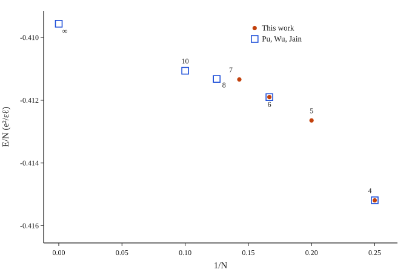
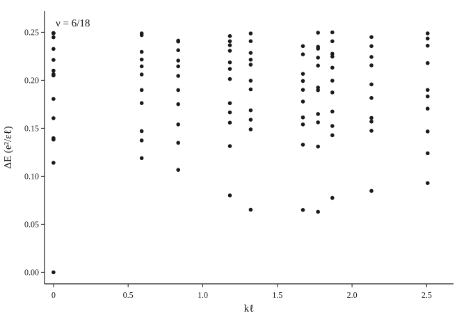

# Laughlin alignment

Starting numerical check for a build or a new eigensolver. The state is the spin-polarized Laughlin liquid at \(\nu=1/3\) on a square torus. Two quantities have to line up: the ground-state energy per electron, and the neutral dispersion \(\Delta E(k\ell)\).

`fqhe check` locks a different cell. The historical monolayer driver sets the aspect ratio to \(\gamma=N/4\), which is square only for four electrons. The tables below use the square cell, \(\gamma=L_x/L_y=1\).

## Geometry

- \(N_\phi=3N\), area \(L_x L_y=2\pi N_\phi\), magnetic length \(\ell=1\), so \(L_x=L_y=\sqrt{2\pi N_\phi}\).
- Lowest Landau level, pure Coulomb interaction, no finite thickness.
- Energies in units of \(e^2/\varepsilon\ell\).
- The ground-state energy is the lowest eigenvalue of the full Fock space. The dispersion uses the same Hamiltonian, blocked by the conserved orbital sum \(J=\sum_i m_i \bmod N_\phi\).

Set this cell on `monolayer_system` with `legacy_monolayer_gamma = false` and `gamma = 1`.

## Ground-state energy

The diagonalization adds a classical self-energy \(W\) on every many-body diagonal. `madelung_monolayer` sums the images in the positive quadrant \(i,j\ge 0\). The square-torus convention of Yoshioka, and of Pu, Wu, and Jain, sums every nonzero image \((m,n)\). The interaction spectrum is unchanged. The per-electron shift from the quadrant sum to the full lattice is \(\delta W=W_\mathrm{full}-W_\mathrm{code}\), and the aligned energy per electron is \(E_0/N+\delta W\).

The ground level is exactly three-fold, the center-of-mass degeneracy of \(\nu=1/3\).

| \(N\) | \(N_\phi\) | dimension | \(E_0\) from the diagonalization | \(E_0/N\) | \(\delta W\) | \(E_0/N+\delta W\) | Pu, Wu, Jain |
| --- | --- | --- | --- | --- | --- | --- | --- |
| 4 | 12 | 495 | \(-1.67237879\) | \(-0.41809470\) | \(0.00290348\) | \(-0.41519122\) | \(-0.41519\) |
| 5 | 15 | 3003 | \(-2.07620255\) | \(-0.41524051\) | \(0.00259695\) | \(-0.41264356\) | |
| 6 | 18 | 18564 | \(-2.48561289\) | \(-0.41426881\) | \(0.00237068\) | \(-0.41189814\) | \(-0.41190\) |
| 7 | 21 | 116280 | \(-2.89471821\) | \(-0.41353117\) | \(0.00219482\) | \(-0.41133635\) | |

Pu, Wu, and Jain, [Phys. Rev. B 96, 195302 (2017)](https://doi.org/10.1103/PhysRevB.96.195302), Table I, give the Coulomb energy per particle on the square torus \(\tau=i\), including the self-interaction. Their exact column lists \(N=4\), \(6\), \(8\), and \(10\). For \(N=4\) and \(N=6\) the aligned energy rounds to the digits they print. The same table continues \(N=8\): \(-0.41132\), \(N=10\): \(-0.41106\), and the thermodynamic limit \(-0.40956\).

Seven electrons do not fit a dense matrix (about 216 GB). The energy above is the lowest eigenvalue of the 21 orbital-sum blocks, dimensions 5537 and 5538. It agrees with a separate 200-step Lanczos run on the full space.

## Dispersion \(\Delta E(k\ell)\)

\(\Delta E=E-E_0\). The self-energy is the same for every state at fixed \(N\), so \(\delta W\) cancels and the gaps below are the raw eigenvalues.

The Brillouin zone has \(N^2\) points, with \(N=\gcd(N,N_\phi)=N\) at \(\nu=1/3\). The two integers \((s,t)\) are:

- \(t\) from \(J \bmod N\), shifted so the ground state sits at the origin;
- \(s\) from the eigenvalue of a translation by \(q=N_\phi/N=3\) orbitals. That translation preserves \(J\). Its eigenvalue is a power of \(e^{2\pi i/N}\).

The wavevector follows Jolicoeur, [arXiv:1610.04477](https://arxiv.org/abs/1610.04477), Eq. (7), folded into the first zone:

\[
k_x=\frac{2\pi s}{L_x},\qquad k_y=\frac{2\pi t}{L_y},\qquad k\ell=|\mathbf{k}|.
\]

\(s\) and \(t\) are the representatives in \([-N/2,N/2]\). Every translation eigenvalue on these spectra has modulus 1, and the three-orbital shift stays inside the \(J\) block. The three center-of-mass copies of the ground state all land at \(k\ell=0\).

The table is the lowest excitation at each shell of \(|\mathbf{k}|\). C\(_4\) partners share a shell.

| \(N\) | \(k\ell\) | \(\Delta E\) |
| --- | --- | --- |
| 4 | 0 | 0 |
| 4 | 0.7236 | 0.127994 |
| 4 | 1.0233 | 0.096736 |
| 4 | 1.4472 | 0.047174 |
| 4 | 1.6180 | 0.060496 |
| 4 | 2.0467 | 0.076021 |
| 5 | 0 | 0 |
| 5 | 0.6472 | 0.109511 |
| 5 | 0.9153 | 0.092762 |
| 5 | 1.2944 | 0.070966 |
| 5 | 1.4472 | 0.063125 |
| 5 | 1.8306 | 0.082358 |
| 6 | 0 | 0 |
| 6 | 0.5908 | 0.118941 |
| 6 | 0.8355 | 0.106643 |
| 6 | 1.1816 | 0.080064 |
| 6 | 1.3211 | 0.065143 |
| 6 | 1.6711 | 0.064907 |
| 6 | 1.7725 | 0.063009 |
| 6 | 1.8683 | 0.077461 |
| 6 | 2.1302 | 0.084798 |
| 6 | 2.5066 | 0.092877 |
| 7 | 0 | 0 |
| 7 | 0.5470 | 0.112048 |
| 7 | 0.7736 | 0.103295 |
| 7 | 1.0940 | 0.080280 |
| 7 | 1.2231 | 0.070741 |
| 7 | 1.5471 | 0.062352 |
| 7 | 1.6410 | 0.069377 |
| 7 | 1.7297 | 0.074405 |
| 7 | 1.9722 | 0.083907 |
| 7 | 2.3207 | 0.079659 |

The lowest excitation, which is also the gap reported by a full-space diagonalization:

| \(N\) | \(k\ell\) of the minimum | \(\Delta E\) |
| --- | --- | --- |
| 4 | 1.4472 | 0.047174 |
| 5 | 1.4472 | 0.063125 |
| 6 | 1.7725 | 0.063009 |
| 7 | 1.5471 | 0.062352 |

On the six-electron grid the shells next to \(k\ell\approx 1.4\) are \(1.3211\) (\(\Delta E=0.065143\)) and \(1.6711\) (\(\Delta E=0.064907\)). The lowest point of that system lies one shell higher.

The first excited level that stays at \(k\ell=0\):

| \(N\) | \(\Delta E(k\ell=0)\) |
| --- | --- |
| 4 | 0.150252 |
| 5 | 0.132384 |
| 6 | 0.114058 |
| 7 | 0.126445 |

Jolicoeur's torus spectra use a rectangular cell of aspect ratio \(0.9\) and place the magnetoroton minimum near \(K\ell\approx 1.5\) for five to twelve electrons. On the square cell the four- and five-electron minima are at \(1.447\), and the seven-electron minimum is at \(1.547\).

Balram and Jain, [arXiv:1609.01703](https://arxiv.org/abs/1609.01703), Table 2, give the composite-fermion gaps in the thermodynamic limit: the neutral (roton) gap \(0.066(1)\) and the long-wavelength gap \(0.150(1)\). Their Table 1 places the first roton minimum at \(k\ell=1.40\). The five-, six-, and seven-electron minima sit at \(0.063\), \(0.063\), and \(0.062\). The four-electron level at \(k\ell=0\) is \(0.150252\). For five or more electrons the lowest \(k\ell=0\) state drops below that long-wavelength value; Jolicoeur identifies this level with the two-roton state discussed by He and Platzman.

Girvin, MacDonald, and Platzman, [Phys. Rev. B 33, 2481 (1986)](https://doi.org/10.1103/PhysRevB.33.2481), obtain the same shape from the single-mode approximation: a finite gap at \(k=0\) and a minimum at finite \(k\ell\).
